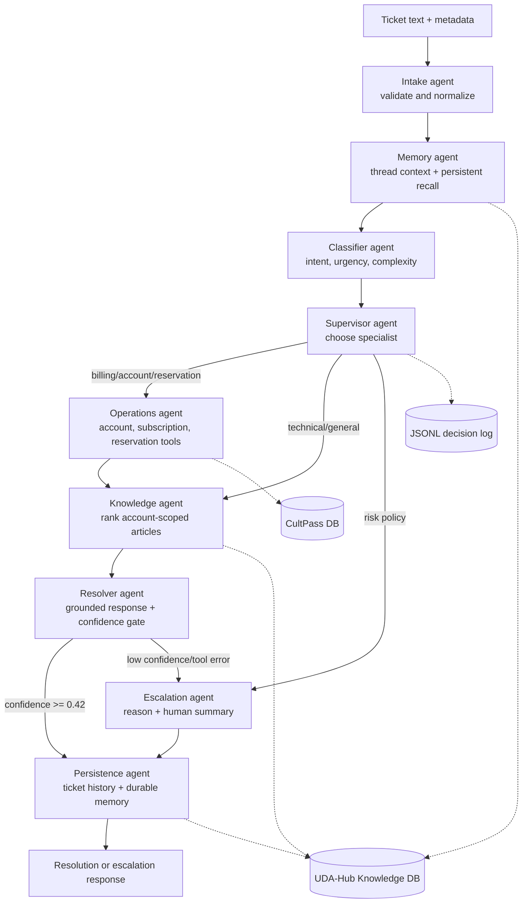

# UDA-Hub Agentic Architecture

## Pattern and goals

UDA-Hub uses the **supervisor pattern**. A supervisor reads the classifier's
structured result and sends the ticket to either an operations specialist, the
knowledge specialist, or immediate human escalation. The design is deterministic
by intent: decisions can be audited and tested, and no support claim can be
invented by a model.

The implementation has seven specialized agents (graph nodes): Intake, Memory,
Classifier, Supervisor, Operations, Knowledge, Resolver, plus an Escalation agent
and a Persistence agent. Each node receives and returns a shared typed LangGraph
state. Agents never access SQLite directly; repositories and support tools are
injected when the graph is built.

## Architecture



## Agent responsibilities

| Agent | Responsibility | Primary output |
|---|---|---|
| Intake | Validate required ticket fields, normalize metadata, identify current message | normalized `ticket` |
| Memory | Load prior interactions/preferences/resolutions for the external user; inspect checkpoint messages | `memory_context` |
| Classifier | Classify technical, billing, account, reservation, or general; combine text with urgency, channel, time, and repeat history | `classification` |
| Supervisor | Select a specialist route; bypass automation for fraud, safety, legal, or breach risks | `route` |
| Operations | Invoke structured account, reservation, or subscription tools. Mutations require `execute_action=true` | `tool_results` |
| Knowledge | Retrieve and rank account-scoped KB records with lexical RAG | `knowledge_results`, `retrieval_confidence` |
| Resolver | Compose only from retrieved article content and tool facts; apply the confidence gate | `response`, `outcome` |
| Escalation | Produce a concise hand-off containing classification, urgency, attempts, and reason | escalation `response` |
| Persistence | Save both sides of the interaction, final status, preferences, and successful resolutions | durable records + final AI message |

## Input, state, and output contracts

Input is a `SupportTicket` dictionary:

```json
{
  "ticket_id": "optional-stable-id",
  "account_id": "cultpass",
  "external_user_id": "a4ab87",
  "user_name": "Alice Kingsley",
  "text": "I cannot log in",
  "channel": "chat",
  "urgency": "normal",
  "created_at": "2026-10-11T10:00:00Z",
  "execute_action": false
}
```

The shared `SupportState` carries LangChain `messages`, normalized ticket data,
classification, route, memories, retrieved articles, tool results, confidence,
decision trace, outcome, response, and errors. Nodes return state deltas. The
`messages` field uses LangGraph's `add_messages` reducer, so a checkpointer keyed
by `thread_id` retains short-term conversation context.

Output is a `SupportResult`-compatible state. `outcome` is `resolved` or
`escalated`; `response` is customer-facing; `sources`, confidence, tool results,
classification, route, and decision trace make the decision explainable.

## Routing policy

Classification uses explicit keyword groups, weighted phrases, and metadata.
Urgency comes from both text and ticket metadata. Complexity rises for repeated
contacts and multi-part tickets. The Supervisor chooses:

- `operations` for billing, account, and reservation issues;
- `knowledge` for technical and general how-to issues;
- `escalation` for fraud, safety, legal, privacy-breach, chargeback, or threat
  language.

After the operations route, knowledge retrieval still runs so a response can be
grounded in policy. Thus a normal complete flow is classify → route → tool → RAG
→ resolve → persist. A tool error or retrieval confidence below `0.42` routes to
escalation.

## Retrieval-augmented generation (RAG)

This project uses transparent lexical RAG rather than a remote embedding model:

1. Load only `Knowledge` rows for the ticket's `account_id`.
2. Normalize case/accents, expand domain synonyms (for example `signin` →
   `login`, `money back` → `refund`), and remove stop words.
3. Score title, tags, and body tokens with weights 3.0, 2.4, and 1.0.
4. Add phrase/category bonuses and compute query-token coverage.
5. Return the top three records and a bounded `0..1` confidence.
6. Resolve only when the best score is at least `0.42`; otherwise hand off.

The resolver extracts each article's reviewed “Suggested phrasing” when present
and always returns its title and stable article ID. It never uses un-retrieved
facts. This makes grounding inspectable and avoids dependency on an external API.

## Tools and database abstraction

`CultPassRepository` owns all access to the customer database. Agents use
`SupportTools`, whose methods return a common structured envelope:

```json
{"ok": true, "tool": "lookup_account", "data": {}, "error": null}
```

Available support operations are account/subscription lookup, reservation and
experience lookup, and validated subscription updates (pause, cancel, reactivate).
Unknown customers/actions and database problems become structured errors. The
core repository similarly abstracts knowledge and memory operations.

## Memory

- **Execution state:** every node shares the typed state during one graph run.
- **Short-term/session:** `InMemorySaver` checkpoints message/state history by
  `configurable.thread_id`; the next turn receives earlier messages.
- **Long-term/cross-session:** `customer_memories` stores preferences and prior
  resolutions by account + external user. `ticket_messages` stores complete
  interaction history. The Memory agent loads both even under a new thread ID.

Preferences such as “I prefer email” are extracted on persistence and reflected
in future responses. Resolved cases are stored with classification and source
references for later personalization.

## Observability and errors

Each node appends a human-readable decision trace. Important agent decisions,
routes, retrieval scores, tool input/outcome (without secrets), and final status
are also written as one JSON object per line. Fields include UTC timestamp,
thread ID, ticket ID, event, agent, and structured details, making logs searchable
with standard JSON tooling.

Input validation failures raise `ValueError` before database mutation. Repository
transactions roll back on error. Missing knowledge, unknown users, failed tools,
and high-risk intent all end in a controlled escalation rather than an invented
answer.
